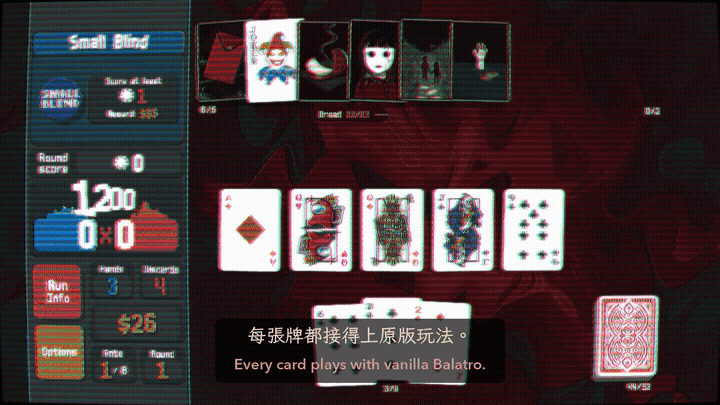
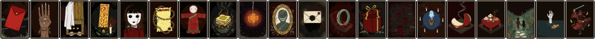

# Cursed Gifts · 詛咒禮物

**A Taiwanese ghost-month folk-horror mod for Balatro.**
In the seventh lunar month the gates of the underworld open. Someone leaves you a gift. You can't destroy it — you can only pass it on. And it always comes back.

> ⚠️ **Content warning:** sudden sounds, screen flashes and distortion, and text about death and folk taboos. On first launch you choose **Ghost Month** (full horror) or **Gentle** (no flashes, no jump-scare sounds). You can change it any time in the mod's config.

## What it adds

- **19 Jokers + 1 Spectral card** drawn from Taiwanese folklore: the Red Envelope on the roadside, Mo-sin-a, the Water Ghost, Moon Blocks, the Offering Table, Zhong Kui's dance…
- **Cursed gifts.** Cursed Jokers are never sold in the shop — they are *given* to you. They can't be destroyed; selling one only passes it on, and it returns a few rounds later.
- **Curses are deals.** Every cursed Joker is stronger than a vanilla Joker of the same rarity — and every one ties into vanilla play: red suits, Pairs, face cards, 7s and 4s, Stone cards, selling, Tarots and Planets.
- **Dread.** Every cursed gift you hold raises Dread. At 13, *it* comes — the screen goes dark and **you choose** which Joker to give it (8 seconds, or it chooses). It leaves an afterimage, a "thank you", and a Spectral card. Each visit brings it closer: 13 → 11 → 9. The third time, it takes *you*. The meter stays hidden until you accept your first gift.
- **Ghost Month calendar.** Once you've touched the mod, Ante 4's boss is always *Ghost Festival* (sell a Joker to calm Dread) and Ante 8's is *The Gate Closes* (every hand adds Dread).
- **Ghost Month Deck.** Start with a Red Envelope on your doorstep and four cards carrying a **Talisman Seal** (scoring one calms Dread). The easiest way in.
- **Two Legendary Jokers** from The Soul: *Lord Seven & Lord Eight* and the *City God*.
- **Joss Paper Pack**, the **Peace Talisman** Spectral card, the **Gate Tag**, and two vouchers (*Ghost Offerings* → *Deliverance*).
- **Hover tooltips** explain Dread, Cursed Gifts and Passing On right on the card. **JokerDisplay** supported.
- **3 Ghost Month challenges:** *Find a Replacement*, *Ghost Festival*, *Dance of Zhong Kui*. Open them from **Mods → Cursed Gifts → Ghost Month Challenges** (no need to unlock the vanilla Challenges menu).
- **English, 简体中文, 繁體中文.** Story text is always in Traditional Chinese, with an English translation underneath in English mode.

Plays fine alongside other content mods: Cursed Jokers never appear in the shop, and the vouchers, tag, legendaries, Peace Talisman and ghost-month bosses only show up once you've touched the mod (picked the deck, taken a gift, or started a challenge).

## Install

1. Install [Lovely](https://github.com/ethangreen-dev/lovely-injector) and [Steamodded](https://github.com/Steamodded/smods).
2. Download `CursedGifts-v0.2.0.zip` from Releases and unzip the `CursedGifts` folder into your `Mods` folder.
3. Start Balatro. Modded runs don't count toward Steam achievements (true of all Steamodded mods).

Tested with Balatro 1.0.1o, Steamodded 26.1002.0, Lovely 0.10.0 on macOS.

## Feedback

This is an early version (0.2.0 — the card rework). Bug reports, balance notes and folklore corrections are very welcome — please open an Issue.

## Credits & license

- Code: MIT (see `LICENSE`).
- Card art: original, all rights reserved. Please don't reuse it outside this mod.
- Sounds: original, synthesized for this mod.
- Font: [LXGW WenKai TC](https://github.com/lxgw/LxgwWenkaiTC), SIL Open Font License 1.1 (`assets/fonts/OFL.txt`). Bundled as a subset.

---

## 繁體中文

**台灣鬼月民俗恐怖 Balatro 模組。** 農曆七月，鬼門開。有人送你一份禮物——毀不掉，只能轉送出去，而且它一定會回來。

> ⚠️ 含恐怖內容：突然的聲音、畫面閃爍與扭曲，以及關於死亡和民俗禁忌的文字。第一次啟動時可選「鬼月」（完整恐怖）或「溫和」（不閃爍、不驚嚇），之後隨時能在模組設定裡改。

- 19 張小丑 + 1 張幻靈牌：路邊紅包、魔神仔、水鬼、擲筊、普渡供桌、跳鍾馗……
- 詛咒不是買來的，是被送來的：詛咒牌不在商店賣，毀不掉，賣出只是轉送，幾回合後會回來。
- 詛咒是交易：每張詛咒牌都比同稀有度的原版牌強，也都接得上原版玩法（紅色花色、對子、人頭牌、7 和 4、石頭牌、賣牌、塔羅星球）。
- 恐懼值：身上的詛咒越多越高，到 13 「它」就來——畫面暗下來，由你親手選一張小丑交出去（8 秒不選它自己挑），它留下殘影、「謝謝你。」和一張幻靈牌。一次比一次近：13 → 11 → 9，第三次它帶走的是你。收下第一份禮物之前，恐懼條不會出現。
- 鬼月日曆：底注 4 的 Boss 固定是「中元普渡」，底注 8 是「關鬼門」。
- 鬼月牌組：開局門口就有一份路邊紅包，4 張牌帶「符印」（計分時恐懼 -1）。
- 兩張傳奇：七爺八爺、城隍爺。另有紙錢包、平安符（幻靈）、鬼門標籤、兩張優惠券（中元供品 → 超渡）。
- 牌上的懸浮說明會解釋恐懼、詛咒禮物、轉送；支援 JokerDisplay。
- 三個鬼月挑戰：抓交替、七月半、跳鍾馗（在 Mods → 詛咒禮物 → 鬼月挑戰 直接開始）。

安裝：先裝 Lovely 和 Steamodded，再把 `CursedGifts` 資料夾放進 `Mods`。問題回報請開 Issue。
